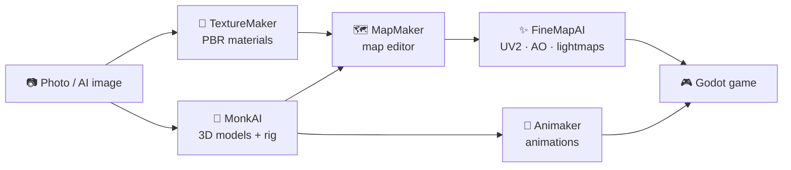

## 👾 About me

I make games — and, mostly, the tools behind them: a chain of small programs that turns photos, images and floor
plans into game-ready 3D maps for **Godot**.

- 🎮 Game development with Godot 4
- 🧱 Blender automation: headless scripts, Cycles bakes, `.glb` in and out
- 🤖 AI-assisted asset creation, using only commercially licensed models

## 🧰 Tech

  
  
  
  
  
  
  
  

## 🔗 The asset pipeline

## 🛠️ Tools I'm building

| | Tool | What it does | Stack |
|:-:|---|---|---|
| 🎨 | **TextureMaker** | Photo or AI image → tileable PBR material (albedo, normal, roughness); paints 3D models | Python |
| 🗿 | **MonkAI** | Image → game-ready 3D model (`.glb`) with retopology and rig | Python |
| 🕺 | **Animaker** | Text → animations for MonkAI characters | JavaScript |
| 🗺️ | **MapMaker** | Map editor built in Godot: floor plan → `.glb`, map info and navigation grid | Godot · GDScript |
| ✨ | **FineMapAI** | Finishing pass for `.glb`: UV2, baked AO, lightmaps and light probes, headless in Blender | Python · Blender |

Most of these are private while in development.

