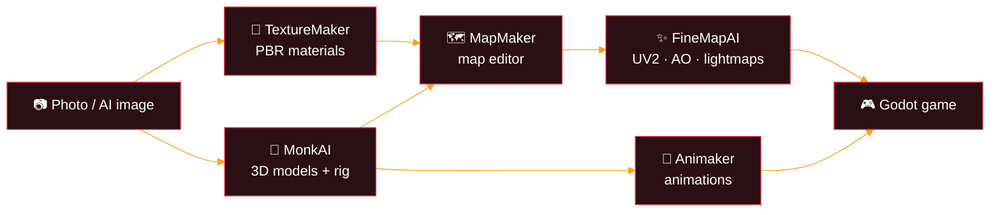
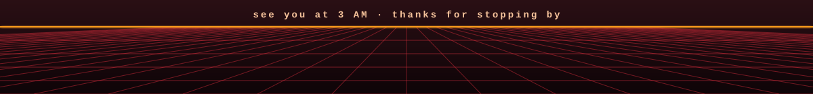

<div align="center">




</div>

## 🌃 About me

I make games — and, mostly, the tools behind them: a chain of small programs that turns photos, images and floor
plans into game-ready 3D maps for **Godot**. Usually late at night, with lo-fi on.

```console
hattori@night-city:~$ status
  🎧 now playing   lo-fi beats to bake lightmaps to
  ☕ coffee        3rd cup
  🛠️ building      a 3D asset pipeline for Godot games
  🤖 AI rule       commercially licensed models only
```

## ⚡ Tech

<p>
  
  
  
  
  
  
  
  
</p>

## 🔗 The asset pipeline



## 🛠️ Tools I'm building

| | Tool | What it does | Stack |
|:-:|---|---|---|
| 🎨 | **TextureMaker** | Photo or AI image → tileable PBR material (albedo, normal, roughness); paints 3D models | Python |
| 🗿 | **MonkAI** | Image → game-ready 3D model (`.glb`) with retopology and rig | Python |
| 🕺 | **Animaker** | Text → animations for MonkAI characters | JavaScript |
| 🗺️ | **MapMaker** | Map editor built in Godot: floor plan → `.glb`, map info and navigation grid | Godot · GDScript |
| ✨ | **FineMapAI** | Finishing pass for `.glb`: UV2, baked AO, lightmaps and light probes, headless in Blender | Python · Blender |

<sub>Most of these are private while in development.</sub>

<div align="center">

</div>
